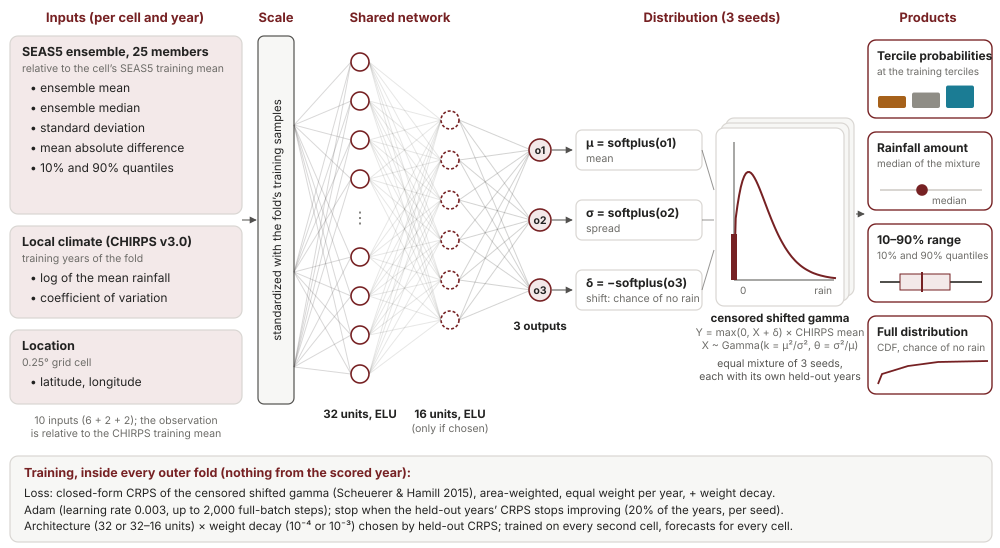

# Neural distributional regression (DRN): a neural EMOS against the published pipeline

A compact distributional regression network (Rasp & Lerch 2018) with a censored shifted gamma output, the distribution of the
EMOS model (docs/48). It learns how the SEAS5 ensemble and the local rainfall climate of a cell relate to the distribution of
the observed CHIRPS rainfall. From that distribution come the rainfall amounts, the 10–90% ranges and the tercile
probabilities. The question is whether modest nonlinear flexibility improves on EMOS and on the published approach,
especially for rainfall amounts and their uncertainty.

Code: `scripts/neural_calibration.py` (the model), run by `scripts/dist_benchmark.py` with
`config/probability_calibration/<cycle>_neural.json`; results `outputs/probability_calibration/<cycle>/neural/`; site:
*Research › Neural network (DRN)*; tests `tests/test_neural_calibration.py`. **Nothing here changes the published forecast.**

## 1. What is compared

| Model | Role | Inputs | Fitting |
| --- | --- | --- | --- |
| `drn_csg` — DRN | candidate (the only model tested for adoption) | ensemble mean, median, standard deviation, mean absolute difference, 10% and 90% quantiles (relative); log CHIRPS mean, CHIRPS coefficient of variation; latitude, longitude | shared network, 1 or 2 hidden layers (32, or 32 and 16 units), CRPS |
| `emos_csg` — EMOS | comparator: does the network add anything? | ensemble mean and mean absolute difference | linear, maximum likelihood (docs/48) |
| `drn_linear_csg` — linear control | is a gain due to the hidden layers, or to the extra inputs and the CRPS loss? | as the DRN | no hidden layer, CRPS |
| `drn_climatology` — ablation | does the SEAS5 forecast add anything beyond the cell's normal rainfall? | log CHIRPS mean, coefficient of variation, latitude, longitude | as the DRN |

References in the same folds and on the same cells: the published probabilities (MVS, smoothed tercile counts and the
climatology blend) for the RPS, and the MVS-corrected ensemble for the CRPS. **Every model uses the first 25 SEAS5 members
in every year** (`members: 25`), the operational policy from 2027 (docs/52), so hindcasts and forecasts have the same
ensemble size.

Only the DRN enters the tests for adoption (5 targets per cycle and score): EMOS, the control and the ablation are
diagnostic comparisons, reported without adjustment, and do not dilute the multiple-testing correction.

## 2. Implementation (`scripts/neural_calibration.py`)



*The model at a glance* (drawn by `web/src/lib/drn_diagram.js`, the same drawing as the research page *Neural network (DRN)* and
the scientists' deck; this copy has fixed colours). Inputs (10 per cell and year): ensemble mean, median, standard deviation,
mean absolute difference, 10% and 90% quantiles of the first 25 SEAS5 members, each divided by the cell's SEAS5 training mean;
the log of the cell's CHIRPS training mean and its coefficient of variation; latitude and longitude. Target: the CHIRPS total
divided by the cell's CHIRPS training mean. Outputs: the mixture distribution F; terciles F(q₁), F(q₂) − F(q₁), 1 − F(q₂) at
the cell's training terciles; the median; the 10–90% range; the chance of no rain F(0). Parameters: 451 with one hidden layer,
931 with two.

### 2.1 Samples and inputs (`dist_benchmark.fold`, `dist_calibration.features`)

As for every distribution model: within each fold, every valid cell (training-mean CHIRPS and SEAS5 at least 1 mm) and
training year is one sample; amounts are relative to the cell's training CHIRPS mean (the observation) or SEAS5 mean (the
ensemble summaries); weights are the cell areas, with equal total weight per year. The DRN adds the ensemble median and the
cell's latitude and longitude. Every input is standardized with the training samples of the fold.

### 2.2 Network and output (`_forward`)

```
h = ELU(x W1 + b1)                    (and h = ELU(h W2 + b2) for two layers)
o = h W + b                           three outputs
μ = softplus(o1) + 0.001,  σ = softplus(o2) + 0.001,  δ = −softplus(o3)
k = (μ/σ)²,  θ = σ²/μ                 Y = max(0, X + δ) · (CHIRPS mean),  X ~ Gamma(k, θ)
```

The same parameterization as EMOS, so the comparison isolates how the parameters depend on the inputs. The output layer
starts near zero weights with biases at the training mean and standard deviation: the network starts from a climatological
distribution.

### 2.3 Loss and gradient (`crps_csg`, `_loss_grad`)

The loss is the area- and year-weighted CRPS of the censored shifted gamma in closed form (Scheuerer & Hamill 2015, eq. 5),
plus weight decay 10⁻⁴ on the weights:

```
CRPS = θ ỹ (2 P_k(ỹ) − 1) − θ c̃ P_k(c̃)² + θ k (1 + 2 P_k(c̃) P_{k+1}(c̃) − P_k(c̃)² − 2 P_{k+1}(ỹ))
       − θ k / π · B(½, k + ½) (1 − P_{2k}(2c̃)),       ỹ = (y − δ)/θ,  c̃ = −δ/θ
```

with P_a the regularized lower incomplete gamma function (P_{a+1} from P_a by recurrence). The test suite checks it
against numerical integration of the CDF. The derivatives of each sample's CRPS with respect to (μ, σ, δ) are taken by
forward differences in double precision (the derivative of the incomplete gamma function with respect to its shape has no
closed form), then back-propagated through the network by hand; the test suite checks the whole gradient against finite
differences. NumPy and SciPy only: no deep-learning library is needed for a network of this size.

### 2.4 Training (`_train`, `fit`)

- **Optimizer:** full-batch Adam, learning rate 0.003, at most 2000 steps.
- **Early stopping:** about 20% of the fold's training years (5 of 23) are held out; their CRPS is checked every 10 steps,
  and training stops after 15 checks without improvement, keeping the best weights.
- **Seeds:** three, each with its own held-out years and initial weights.
- **Architecture:** one hidden layer of 32 units, or two of 32 and 16, chosen by the mean held-out CRPS of the three seeds.
  Everything is chosen inside the outer fold; the left-out year is never seen.
- **Forecast:** the equal mixture of the three seeds' distributions (`CSGMixture`): its CDF is the mean of theirs, its
  quantiles found by bisection.
- **Training cells:** every second cell in each direction of the 0.25° grid (neighbouring cells carry nearly the same
  information), which makes training four times faster; forecasts and scores cover every cell.
- The linear control uses the same procedure without a hidden layer and without weight decay.

### 2.5 Products

Tercile probabilities `P(below) = F(q1)`, `P(near) = F(q2) − F(q1)`, `P(above) = 1 − F(q2)` with the training-year CHIRPS
terciles q1, q2 (the convention of every distribution model); amounts, median and 10–90% range from the quantiles.

### 2.6 Evaluation and decision

As every benchmark: outer leave-one-year-out over 1993–2016, then fitted on all of 1993–2016 for the test years; scores per
year area-weighted over All Ethiopia (RPS, CRPS, pinball losses, 10–90% coverage); one-sided paired sign-flip test over
whole years. The benchmark's own decision uses Holm across the DRN's five targets; the method selection uses
Benjamini–Hochberg on the same p-values (docs/50). A confirmed DRN becomes a candidate, which needs three independent
validation seasons (a shadow forecast) before it can be recommended.

**Caveats on the evidence.** Each fold has 23 seasons: pooling over cells helps estimation, but the evidence for a new year
still comes from those seasons, and the tests use whole years. The years 2017 onward have been looked at during the
development of the other methods; they are a check, not an untouched test set. Real evidence will come from forecasts saved
before their seasons (docs/52).

## 3. Results (All Ethiopia, four cycles, 20 targets)

| Mean over the 20 targets | DRN | EMOS | Linear control | No-forecast ablation | Published |
| --- | --- | --- | --- | --- | --- |
| Amounts, CRPSS 1993–2016 | +0.025 | +0.024 | +0.022 | +0.006 | +0.009 (MVS ensemble) |
| Amounts, CRPSS 2017+ | +0.016 | | | | +0.011 |
| Coverage of the 10–90% range, 1993–2016 (nominal 80%) | 81% (75–90%) | 80% | | | 67% (46–76%) |
| Probabilities, RPSS 1993–2016 | +0.013 | −0.003 | | | +0.022 |

- **Rainfall amounts.** The DRN is better than the published MVS ensemble on average over 1993–2016 for 16 of 20 targets
  and over the test years for 10. **Confirmed better only for JJAS September** (Holm and Benjamini–Hochberg, adjusted p
  0.011; 17 of 24 years better, better over the test years too). Close: FMAM-February February (unadjusted p 0.015) and
  JJAS June and August (0.045 and 0.032; Benjamini–Hochberg 0.075).
- **Ranges.** The clearest gain: the DRN's 10–90% ranges hold 75–90% of the observations (mean 81%), against 46–76% for the
  MVS ensemble, whose ranges are too narrow. EMOS is as well calibrated (80%).
- **Against EMOS:** about equal. The DRN's CRPS is lower for 9 of 20 targets; significantly so (unadjusted) only for
  FMAM-February February and JJAS August. **The network does not add a clear gain over EMOS.**
- **Against the linear control:** lower CRPS for 13 of 20 targets, significantly (unadjusted) for the JJAS season and ONDJ
  December: the hidden layers help a little at most. One hidden layer or two were chosen (32–16 units for 16 targets).
- **Against the no-forecast ablation:** the decisive check. The ablation (the cell's climate and location only) beats the
  MVS ensemble for 14 of 20 targets, because the MVS ensemble's amounts are worse than climatology for many targets. The
  DRN beats the ablation for only 11 of 20, significantly only for FMAM-February February, where SEAS5 has real skill
  (DRN RPSS +0.205, published +0.137). **Most of the DRN's gain over the published amounts comes from a well-calibrated
  distribution, not from the forecast.**
- **Tercile probabilities:** the DRN is below the published probabilities on average (RPSS +0.013 against +0.022) and better
  for 4 of 20 targets, none confirmed (FMAM-February February comes closest, unadjusted p 0.013).
- **Training:** early stopping ended most networks after about 30 steps (median), close to their starting point (a
  climatological distribution): with 18 training years per network, the held-out years stop the networks before they learn
  much from the forecast.
- **Pooled over the 20 targets and 1993–2025** (docs/50, "More statistical power"): the DRN's amounts are significantly
  better than the MVS ensemble (skill gain +2.2% of the climatology score, better in 27 of 33 years; Holm p 0.015,
  Benjamini–Hochberg 0.004); its probabilities are not (−1.2%).

### 3.1 Rerun with the weight-decay search (`drn-stage1-v2`, accepted 2026-10-21)

The table above is the first run (`drn-stage1-v1`: 32 or 32–16 units, weight decay fixed at 10⁻⁴). The rerun searches
architecture × weight decay (10⁻⁴ or 10⁻³) inside every fold and adds Brier skill, range width and reliability; it ran the code
of commit c221c2d in all four cycles (accepted as a batch, `scripts/accept_results.py`). Means over the 20 targets:

| | DRN, first run | DRN, rerun | EMOS | Published |
| --- | --- | --- | --- | --- |
| Amounts, CRPSS 1993–2016 | +0.025 | +0.024 | +0.024 | +0.009 |
| Amounts, CRPSS 2017+ | +0.016 | +0.016 | +0.024 | +0.011 |
| Coverage of the 10–90% range, 1993–2016 | 81% | 81% (75–89%) | 80% | 67% |
| Probabilities, RPSS 1993–2016 | +0.013 | +0.014 | −0.003 | +0.022 |
| Probabilities, RPSS 2017+ | +0.013 | +0.017 | +0.008 | +0.028 |

- The stronger weight decay was chosen for 13 of 20 targets and two hidden layers for 18 (network fitted on 1993–2016);
  early stopping still ends training after a median of 35 steps (at most 630).
- The conclusions do not change: amounts better than the published ensemble for 15 of 20 targets over 1993–2016 and 9 over the
  test years; about equal to EMOS (lower CRPS for 10 of 20); better than the no-forecast ablation for only 11 of 20; tercile
  probabilities better than the published ones for 6 of 20, none confirmed. **Confirmed only for JJAS September amounts**
  (−1.08 mm over 1993–2016, 18 of 24 years better, Benjamini–Hochberg p 0.014).
- Largest changes per target: FMAM-January February (CRPSS +0.065 to +0.082), ONDJ December (+0.031 to +0.021) and the ONDJ
  season (+0.035 to +0.020): regularization trades a little in some targets for a little in others.
- JJAS September: the rerun DRN (−1.0825 mm) and quantile regression (−1.0827 mm) are now practically identical; under the
  practical tie rule (docs/50) EMOS (−0.98 mm, within 1% of the published CRPS) is the selected candidate, with the DRN and
  quantile regression as confirmed alternatives. The second stage re-scores the three with the corrected CRPS (3f).

**Reading.** The neural network does what a well-calibrated distribution model does: better amount ranges than the published
ensemble, about as good as EMOS. It does not find additional, nonlinear forecast signal: with about two dozen seasons per
fold, the year-to-year evidence is too thin for a network to learn more than EMOS's few coefficients. Where SEAS5 is skilful
(February), the DRN uses it and does well, as EMOS does. In the method selection the DRN is confirmed for JJAS
September amounts; its improvement over 1993–2016 (−1.10 mm in the first run, −1.08 mm in the rerun) is practically that of
quantile regression (−1.08 mm), and under the practical tie rule EMOS is the selected candidate there. A recommendation would need three shadow-forecast seasons, and the
ablation result is a reason for caution. The results support the recommendation's order: a spatial CNN or a larger network is not
justified by these data; more forecast information (predictors) and more independent seasons would come first.

## 3b. Validation seasons (shadow forecasts)

A DRN listed by the method selection gets its own amount shadow (`scripts/dist_shadow.py`, docs/48), like every distribution
model: fitted on the cycle's reference years with the first 25 members (`members` in
`config/probability_calibration/amount_shadow.json`) and the cell coordinates, made when the cycle is run and scored once
CHIRPS is available. **2026, JJAS September (its first season):** CRPS skill +0.052 against +0.188 for the MVS ensemble —
worse, as EMOS and quantile regression were that season; 1 of the 3 seasons needed. From 2027 the shadows are made before
each season (docs/52).

## 3c. Second stage: more information, a neural correction of EMOS, the mirror ablation

A separate benchmark (`config/probability_calibration/<cycle>_neural_ext.json`, results in `.../neural_ext/`) with its own two
candidates, so their test family is separate from the first stage's:

| Model | Role | What it adds |
| --- | --- | --- |
| `drn_sst` — DRN + SST indices and regions | candidate | The DRN inputs plus the SEAS5 Niño 3.4 (5° S–5° N, 170°–120° W) and Indian Ocean Dipole (west 10° S–10° N, 50°–70° E minus east 10° S–0°, 90°–110° E) indices of the target months (first 25 members, cos-latitude weighted means; `scripts/sst_indices.py`), and the eight EMI homogeneous rainfall regions (Korecha & Sorteberg 2013, one-hot). The indices give the network large-scale information it did not have; they are known at issue time. The regions are a published regionalization: the project's own regime masks were not used because they are built from 1993–2025 CHIRPS, held-out years included. |
| `drn_emos_residual` — neural correction of EMOS | candidate | For each seed, EMOS (maximum likelihood) is fitted on the seed's training years; the network's three outputs are **added** to EMOS's linear predictors of μ, σ and δ. The output layer starts at zero, so training starts exactly at EMOS, and early stopping keeps EMOS when no step improves the held-out CRPS; a penalty (0.01) on the mean squared correction keeps it small. It asks the cleanest question: is there any nonlinear signal beyond EMOS? |
| `drn_forecast_only` — ablation | diagnostic | The network on the ensemble summaries only (no climatology, location or indices): the mirror of the no-forecast ablation. |
| `emos_csg` | diagnostic | EMOS in the same folds. |

After the review (3f) the second stage also refits the plain DRN, EMOS and quantile regression on the same folds, so that every
comparison uses one scoring rule (CRPS scoring version 2), and adds a regions-only DRN (`drn_regions`), so that `drn_sst`
against `drn_regions` is the value of the SST indices alone. Comparisons: DRN + SST against the DRN (the value
of the indices and regions), the neural correction against EMOS and against the DRN, the DRN against the forecast-only
ablation (the value of the local context). Both candidates also have amount shadows when selected (`amount_shadow.json`:
25 members; the SST indices and regions of the forecast year for `drn_sst`).

### Results (`drn-stage2-v1`, accepted 2026-10-22; CRPS scoring version 2)

| Mean over the 20 targets | Published | EMOS | QR | DRN | DRN + regions | DRN + SST | Neural correction of EMOS | Forecast only |
| --- | --- | --- | --- | --- | --- | --- | --- | --- |
| Amounts, CRPSS 1993–2016 | +0.009 | +0.024 | +0.024 | +0.024 | +0.026 | +0.021 | +0.025 | +0.016 |
| Amounts, CRPSS 2017+ | +0.011 | +0.024 | +0.025 | +0.015 | +0.012 | +0.022 | +0.025 | +0.012 |
| Probabilities, RPSS 1993–2016 | +0.022 | −0.003 | −0.008 | +0.014 | +0.015 | +0.017 | +0.011 | −0.002 |
| Probabilities, RPSS 2017+ | +0.028 | +0.008 | −0.006 | +0.017 | +0.010 | +0.015 | +0.019 | +0.003 |

- **Confirmed better than the published approach** (Benjamini–Hochberg within this benchmark's two candidates × 5 targets,
  per score, not worse over the test years): the **neural correction of EMOS** for FMAM-February February, both
  **probabilities** and amounts, and for JJAS September amounts; **DRN + SST** for JJAS September amounts. The correction of
  EMOS is the first neural model confirmed for tercile probabilities.
- **The SST indices do not add a consistent signal:** DRN + SST has a lower CRPS than the regions-only DRN for only 9 of 20
  targets over 1993–2016 (mean CRPSS +0.021 against +0.026), though it does better over the test years (+0.022 against
  +0.012), notably in ONDJ (November and the season), where strong Indian Ocean years fall in 2017–2025.
- **The neural correction of EMOS** is lower in CRPS than EMOS for 10 of 20 targets: small corrections, sometimes useful,
  consistent with a penalized network that starts at EMOS.
- **Local context matters:** the forecast-only ablation is clearly weaker (CRPSS +0.016), as the no-forecast ablation was.
- **The corrected CRPS** changes the DRN's scores by a few hundredths of a percent (ONDJ: +0.02% to +0.06%); for JJAS
  September the DRN (−1.0800 mm) and quantile regression (−1.0795 mm) remain practically identical.
- **Method selection** (practical tie rule): FMAM-February February amounts now have a candidate, the neural correction of
  EMOS (−0.36 mm over 1993–2016, −0.24 mm over the test years); for February probabilities square-root MVS keeps the larger
  gain (−0.037 against −0.031 RPS); for JJAS September the correction has the largest gain (−1.12 mm), but EMOS (−0.98 mm) is
  within 1% of the published CRPS, so the simplest, EMOS, stays selected. Each needs three validation seasons (shadow forecasts
  from 2027).
- Production note: the folds ran with the code of e4847a0; the final assembly of each cycle failed on a missing
  `SCORING_VERSION` constant (the staging patch skipped it) and was completed from the checkpoints with the constant set,
  nothing refitted (recorded in `config/accepted_results.json`).

## 3d. One network for the months of a cycle (`scripts/pooled_benchmark.py`)

Each per-target DRN learns from about 18 training seasons. `drn_pooled` fits **one** network to the four months of a cycle
(not the season, whose observations are the sum of the months'): the samples of every month (as `dist_benchmark.fold` makes
them, each month with total weight 1) are pooled, with the month's position in the season as four one-hot inputs. Four times
the samples per network — but from the same years, which are correlated across the months, so the gain in independent
information is smaller than the factor four. Early stopping holds out whole calendar years for the four months at once
(`year_index` of each row).

The driver works per year rather than per target (one fit serves the four months): outer leave-one-year-out over 1993–2016,
every month of the left-out year forecast and scored with the published references computed in the same folds, then one
fit on all training years for the test years. Results have the same format as `dist_benchmark.py`; Holm across the four
targets (the method selection: Benjamini–Hochberg); comparisons with the per-target DRN and EMOS read from the first stage.
Its shadow forecast (`dist_shadow.py`, since 2026-10-23) fits the pooled network once per cycle on the four months of the
reference years, as the benchmark's final fit, and forecasts each month with its own position; the season total has no
pooled shadow. The fingerprint covers the four months' inputs, and the fit stops if a cycle orders its months differently
from the benchmark (the month inputs would change meaning).

Config: `config/probability_calibration/<cycle>_neural_pooled.json`; results `.../neural_pooled/`. After the review (3f) the
comparisons read the per-target DRN and EMOS of the second stage (same folds, same corrected CRPS).

### Results (`drn-pooled-v1`, accepted 2026-10-22; 16 month targets, CRPS scoring version 2)

| Mean over the 16 months | Pooled DRN | Published |
| --- | --- | --- |
| Amounts, CRPSS 1993–2016 | +0.035 | +0.007 (MVS ensemble) |
| Amounts, CRPSS 2017+ | +0.029 | +0.000 |
| Coverage of the 10–90% range, 1993–2016 (nominal 80%) | 81% | 65% |
| Probabilities, RPSS 1993–2016 | +0.023 | +0.020 |
| Probabilities, RPSS 2017+ | +0.023 | +0.022 |

- **The strongest neural result.** Pooling the four months gives each network four times the samples from the same years;
  the pooled DRN has a lower CRPS than the per-target DRN for 13 of 16 months and than EMOS for 14 of 16 (1993–2016).
- **Confirmed better than the published amounts** (Benjamini–Hochberg, not worse over the test years) for FMAM-January
  March, April and May and JJAS June and September. Its probabilities match the published ones on average (+0.023 against
  +0.020 over 1993–2016) — the first neural model to do so — but none is confirmed.
- Part of the amount gain is over a weak reference: the MVS ensemble's amounts are worse than climatology for many months
  (JJAS June CRPSS −0.096); the pooled DRN is close to or above climatology everywhere except ONDJ January.
- The stronger weight decay was chosen for FMAM and JJAS (32–16 units for FMAM-January and JJAS, 32 for FMAM-February), the
  weaker for ONDJ (32 units).
- **Method selection:** the pooled DRN is the selected candidate for FMAM-January March, April and May amounts (none before)
  and JJAS June and September amounts (−1.73 and −1.29 mm over 1993–2016; for September EMOS is now more than 1% behind,
  and of the tied neural candidates the pooled DRN has the larger gain).
- **Validation:** its shadow forecast exists since 2026-10-23 (above), so the pooled candidates collect independent seasons like
  the others, from 2027 frozen before each season (the 2026 shadows are retrospective reconstructions). The first, JJAS June
  2026, was a dry month that the MVS ensemble fitted better (CRPSS +0.12 against +0.33): one season, three are needed.
- Production note: the JJAS run started from the queue (code of e4847a0); the other three cycles were restarted after the
  queue's loop stopped, with the same unchanged code; each assembly was completed from the checkpoints (missing
  `SCORING_VERSION` constant), nothing refitted.

## 3e. A separate tuning split (`tuning='separate'`)

In the first stage the architecture and weight decay are chosen on the same held-out years that stop the training. This
does not bias the reported scores (the outer left-out year is never seen) but can make the choice of configuration noisier.
With `tuning='separate'` the configuration is chosen by three inner folds of the training years: each fold's years are
scored by a network trained on the other years, early-stopped on a further 20% of them; then the three seeds of the chosen
configuration are trained as usual. `drn_csg_tuned` is the DRN with this procedure, run as a **diagnostic** on JJAS
(`config/probability_calibration/may_jjas_neural_tuning.json`, not a candidate): the comparison with the DRN shows whether
the tuning procedure matters.

Results (`drn-tuning-v1`, JJAS): the separately tuned DRN differs from the DRN by −0.03 to +0.12 mm in CRPS over 1993–2016
(better for August and September, worse for June, July and the season), chose the stronger weight decay (10⁻³) for all five
targets, and has the same pattern of skill (CRPSS −0.008 to +0.017). The tuning procedure does not change the conclusions;
with fewer years for fitting, a separate tuning split costs about as much as it gains.

## 3f. Review follow-ups (20 October 2026)

An external review of the code and results (at commit 6e350da) raised points on scoring, provenance and presentation. What
was found and done:

**CRPS precision (scoring version 2).** `Distribution.crps` integrated (F(x) − 1{x ≥ y})² on one uniform 400-point grid; the
integrand jumps at the observation, which falls between grid points, so the error is of the order of the grid step.
`scripts/crps_precision.py` measures it against the closed form (single censored shifted gammas) and adaptive quadrature
(three-seed mixtures) on 81 dry, ordinary, wet and extreme cases (`outputs/crps_precision/report.json`): up to 0.7% of the score
(9 mm on an extreme wet-season case; 0.15 mm on the review's example, k = 3, θ = 100 mm, δ = −10 mm, y = 210 mm, reproduced
exactly). Splitting the grid at the observation brings the error within 0.15%; the censored shifted gamma is now scored by its
closed form. The results so far (scoring version 1) are kept; the errors partly cancel over cells and years, but the method
selection decided between the DRN and quantile regression for JJAS September amounts on a margin (about 0.02 mm) below the
old rule's error. From the second stage on (scoring version 2): the second stage refits the DRN, EMOS and quantile regression on
the same folds, so every comparison uses one rule (a comparison with results of another scoring version is an error), and the
JJAS September choice can be re-examined. A practical tie rule (a negligible difference does not displace the simpler
candidate) is proposed for the method selection; it changes the rule, so it awaits a decision.

**Experiment provenance.** The runner now records the commit and the hashes of every code and configuration file at the
*start* of the run (the code the workers import), the resume keys, the SST and region files used, the experiment's settings,
and whether HEAD moved during the run. Results already produced keep the provenance they were produced with.

**Accepted results.** The site, the method summary and the method selection read neural results only through
`scripts/accept_results.py` (`config/accepted_results.json`, archived copies in `outputs/accepted/`): a batch is accepted only
when every cycle passes the completeness checks (five targets, years, 25 members, every model with training and test scores,
clean-commit provenance, the evaluated configurations recorded). The published results are `drn-stage1-v1` (architectures 32
and 32-16, weight decay fixed at 10⁻⁴); the rerun with the decay search becomes `drn-stage1-v2` once all four cycles are in. The
neural page states the experiment shown, its commit and configuration, the options actually evaluated, and pending runs.

**Training diagnostics.** Each seed records its best step, the steps run, why training stopped (early stopping, the step limit,
or a non-finite loss, gradient or validation score), and whether the starting point was returned; `converged` means early
stopping without non-finite values (it was based on the step count before).

**Second-stage checks.** The neural correction of EMOS now uses exactly EMOS's links, so a zero correction reproduces EMOS
(the mean had a 0.001 floor; the test compared the shape only within 1%, now mean, spread and shift exactly). A regions-only
DRN (`drn_regions`) separates the SST indices from the regions: `drn_sst` against `drn_regions` is the SST effect. A missing or
non-finite SST value is an error, never a zero. The pooled network keeps each row's season year (ONDJ's January with October to
December of its September initialization) and keeps the season total as its own model. The separate tuning split now refits the
input standardization on each inner fitting subset; the relative units (division by the fold's training means) and the
climatology inputs still come from all training years of the outer fold, so this experiment stays a diagnostic.

**Still open.** Saving fold-level predictions so a future scoring change needs no refit; a shadow-forecast path for the pooled
network before it could be validated; the practical tie rule (a decision). Translations need review by fluent speakers.

## 4. Running

    python scripts/dist_benchmark.py --config config/probability_calibration/<cycle>_neural.json --workers 5

About two hours per cycle with five workers (15 networks per fold: 6 for the DRN, 6 for the ablation, 3 for the linear
control). Checkpoints per target in `outputs/probability_calibration/<cycle>/neural/parts/`. JAX was tried first for the
gradients: its incomplete gamma function made one step 0.7 s, against about 20 ms with SciPy and the derivatives above.

## 5. Possible next steps

Following the order recommended for this project: if the DRN improves on EMOS, test why (inputs, depth, a regularized
correction of the EMOS parameters); then pool the monthly targets with the target month and lead as inputs; then add
spatial context with a small patch CNN on the surrounding SEAS5 fields; then run the chosen network as a shadow forecast.

## References

- Rasp, S., & Lerch, S. (2018). Neural networks for postprocessing ensemble weather forecasts. *Monthly Weather Review*, 146(11), 3885–3900.
- Scheuerer, M., & Hamill, T. M. (2015). Statistical postprocessing of ensemble precipitation forecasts by fitting censored, shifted gamma distributions. *Monthly Weather Review*, 143(11), 4578–4596.
- Uttarwar et al. (2025), KIT (publikationen.bibliothek.kit.edu): a censored shifted gamma DRN for SEAS5 precipitation
  trained with the CRPS, where one hidden layer of 25 units did as well as deeper networks (daily forecasts in the first
  month, the Alps). Cited as in the recommendation that led to this benchmark; the full reference is to be completed.
